

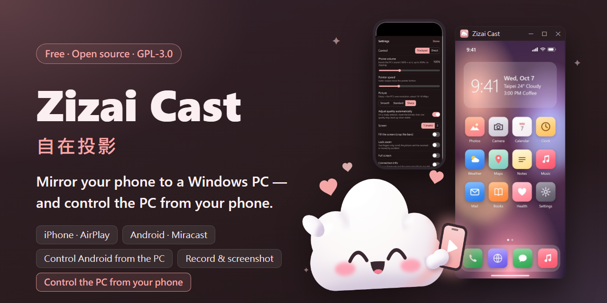

[繁體中文](README.md) ・ **English**

# Zizai Cast 自在投影

**Put your phone on a Windows PC, or the other way round: control the PC from your phone.** 
No app on the iPhone, mouse and keyboard control for Android; remote control needs only a phone browser. Free, open source, no ads, no account.

&nbsp;

[Website](https://victor900106.github.io/ZizaiCast/#en) ・ [All releases](https://github.com/victor900106/ZizaiCast/releases) ・ [FAQ](#faq) ・ [Privacy](#privacy)

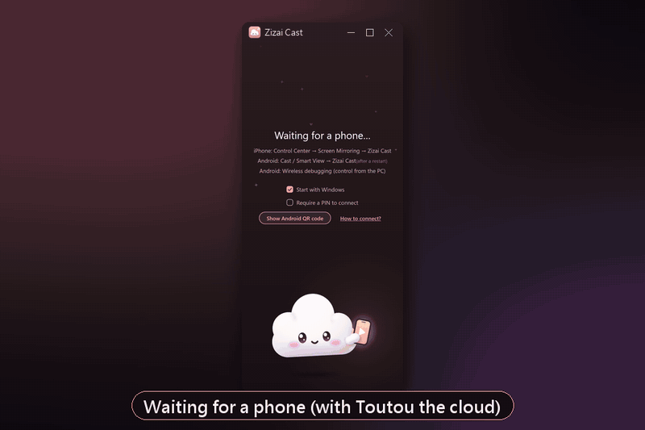

Real app footage (recorded off-screen; title bar and backdrop added afterwards). The phone content is a synthetic demo screen with no real personal data.

---

## Phone mirroring: your phone on the PC

Put the phone and the PC on the same Wi‑Fi, pick “Zizai Cast” on the phone, and picture and sound appear on the PC. Record, capture, zoom and translate in the same window; nothing leaves your home network. Low latency (about 3 ms from decode to display on the PC), up to 4K at 60 fps.

**Before you start**: [download and install](https://victor900106.github.io/ZizaiCast/download/zizai-setup-latest.exe) (no admin rights), put the phone and PC on the same Wi‑Fi (not a guest network; turn VPNs off). When Windows Firewall asks on first start, allow **Private networks**.

| | 1 | 2 | 3 |
|---|---|---|---|
| **iPhone / iPad** (AirPlay, no app) | Control Center → *Screen Mirroring* | Pick **Zizai Cast** | Picture and sound appear on the PC |
| **Android: view only** (Miracast) | Quick Settings → *Cast* (Samsung: *Smart View*) | Pick **Zizai Cast** | The phone appears (the PC needs the Windows “Wireless Display” feature) |
| **Android: control from the PC** (wireless debugging, Android 11+) | *Developer options → Wireless debugging → Pair device with QR code* | Scan the QR code from *Connect a phone ▸ Connect Android (scan QR)* | Mouse and keyboard control; reconnects by itself |

Forgot how? *Connect a phone ▸ How to connect?* is always in the app. An iPhone can't be controlled from the PC (an AirPlay limit).

<table>
<tr>
<td width="33%" valign="top">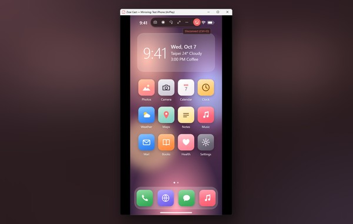 <b>iPhone / iPad mirroring</b> AirPlay, no app on the phone, picture and sound.</td>
<td width="33%" valign="top">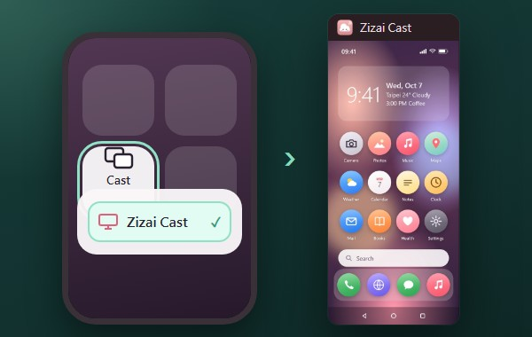 <b>Android Cast</b> Pick Zizai Cast from the phone's Cast / Smart View tile.</td>
<td width="33%" valign="top">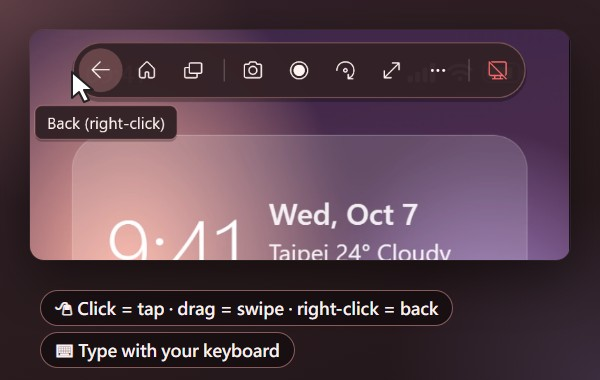 <b>Control Android from the PC</b> Click, swipe, scroll, type; pair with a QR code, it reconnects by itself.</td>
</tr>
<tr>
<td valign="top">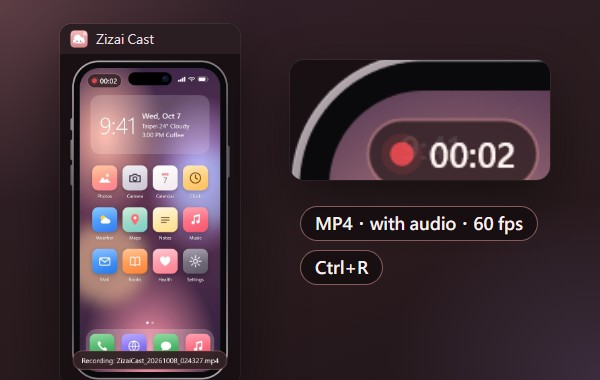 <b>Recording and screenshots</b> Ctrl+R records MP4 (60 fps, with audio), Ctrl+S saves a PNG, Ctrl+F adds an iPhone frame.</td>
<td valign="top">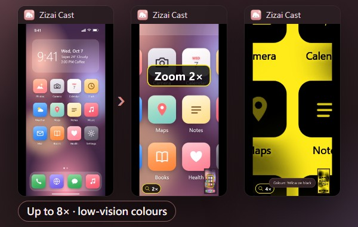 <b>Magnifier and low-vision colours</b> Up to 8×, more contrast, greyscale, inverted, yellow on black; freeze the picture.</td>
<td valign="top">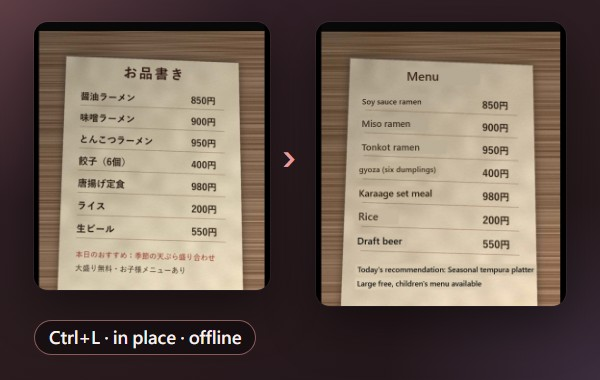 <b>On-screen translation</b> Ctrl+L: English, Japanese, Korean and Simplified Chinese, offline on your PC. The menu is a synthetic test picture.</td>
</tr>
</table>

Also: presentation pen (Ctrl+E), drop files on the window, send to phone, four themes, four UI languages, one-click updates (never by itself).

## Remote control: use the PC from your phone

The other way round: a phone's browser (Safari on iPhone, Chrome on Android) shows you the PC's screen, plays its sound, and lets you control the mouse and keyboard with your fingers, **with no app on the phone**. Off by default: switch to the *Remote control* tab in the main window to turn it on.

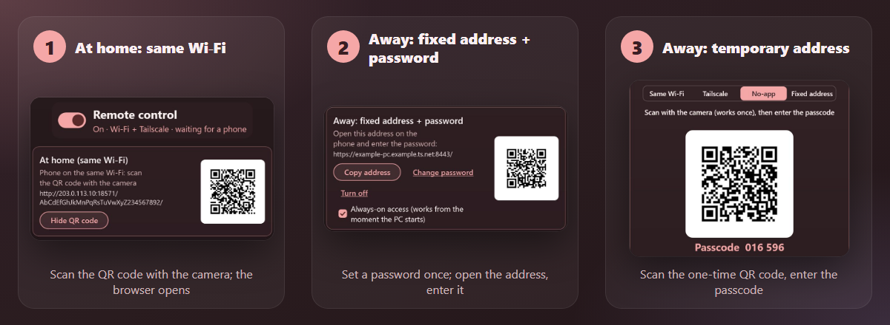

| | 1 | 2 | 3 |
|---|---|---|---|
| **At home**: same Wi‑Fi | Turn it on in the *Remote control* tab, press *Show QR code* | Scan it with the phone's camera | The first time, the PC asks you to *Allow* |
| **Away**: fixed address + password (Tailscale Funnel) | Press *Set password* (8+ characters), turn on the fixed address; tick *Turn the fixed address on when the PC starts* | Open the fixed address in the phone's browser | Enter the password; nothing to do on the PC first |
| **Temporary address** (no install) | Pick the *Temporary* tab: a one-time QR code and a 6-digit passcode appear | Scan the QR code, enter the passcode | Press *Allow* on the PC |

**For a friend**: you only type the password yourself. To let someone in for a while, press *Add a temporary account* in the *Remote control* tab, pick the validity (once to 7 days), operate or view only, and whether files are allowed, then use *Copy all* to send them the address and password. The address already carries the account (after the #), so your friend also only types the password; you press *Allow* on the PC when they connect, and the account is deleted when it expires. (The fixed address has to be on first.)

<table>
<tr>
<td width="50%" valign="top">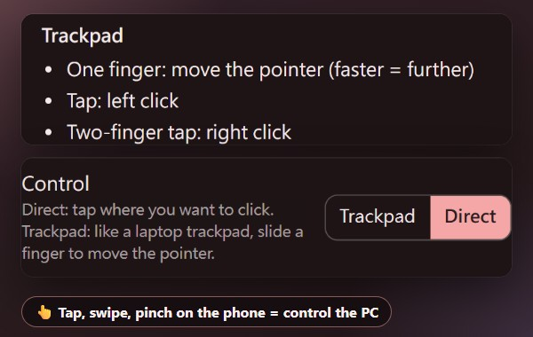 <b>Finger control and trackpad</b> <i>Direct</i> clicks where you tap, or work like a laptop trackpad; a three-finger tap opens the keyboard, with Ctrl / Alt / Win combinations and a two-way clipboard.</td>
<td width="50%" valign="top">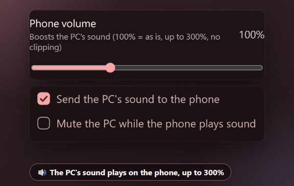 <b>The PC's sound on the phone</b> Whatever the PC plays, the phone plays; the level is adjusted automatically and the phone volume goes up to 400%.</td>
</tr>
<tr>
<td valign="top">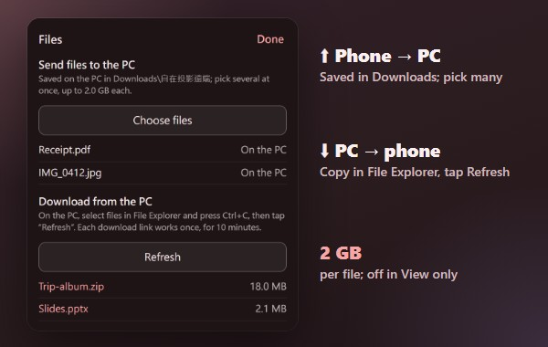 <b>Files both ways</b> Phone to PC (saved in <i>Downloads\自在投影遠端</i>, up to 2 GB each); on the PC copy files in File Explorer and tap <i>Refresh</i> on the phone. Several monitors can be switched too.</td>
<td valign="top">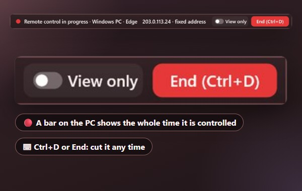 <b>The bar on the PC, and Ctrl+D</b> A bar at the top of the PC shows while connected; press <i>End</i> or Ctrl+D to cut it at any time. <i>View only</i> is one switch away.</td>
</tr>
</table>

**Safety**
- **Off by default**, you turn it on yourself; a bar on the PC shows while connected and you can cut it any time. The PC can lock itself when a phone connected from outside drops (a setting).
- **A new phone has to be allowed on the PC**; wrong passwords are limited per source address without affecting anyone else; the PC stores only a salted hash.
- **Only your own Tailscale account**, no server of ours; only the temporary address passes through Cloudflare. One phone at a time; administrator windows, UAC and the lock screen can't be controlled.

## What's new

| v0.8.3.5 | |
|---|---|
| **From another computer** | Clicking and typing now work from another computer’s browser (every button, wheel, dragging, its input method); a bar at the top for full screen, screens, clipboard and game mode. |
| **Lending to a friend** | One Allow after your friend signs in: switching quality or screens and reconnecting no longer ask again; temporary accounts can transfer files by default. |
| **Fixed address** | Turning remote control off and quickly on again no longer loses the fixed address; a double click on the switch counts once. |
| **Phone page** | Trackpad mode shows where the PC pointer is; a new Stats button; the Files button is greyed with the reason when files are off. |
| **Administrator windows** | Clicking a window run as administrator now tells you why it can’t be reached and what to do. |

Full change list on [Releases](https://github.com/victor900106/ZizaiCast/releases).

## Requirements, downloads and more

<b>Requirements and downloads</b>

- **PC**: Windows 10 / 11, 64-bit. Phone and PC on the same local network (5 GHz Wi‑Fi or a wired PC recommended).
- **iPhone / iPad**: Screen Mirroring. **Android Cast**: the Windows optional feature “Wireless Display” and a supporting Wi‑Fi adapter (Pixel phones don't do Miracast; use wireless debugging). **Android control**: Android 11+ with wireless debugging.
- **1440p / 4K**: HEVC Video Extensions; otherwise 1080p is used.
- Download: [`zizai-setup-<version>.exe`](https://victor900106.github.io/ZizaiCast/download/zizai-setup-latest.exe) ([Releases backup](https://github.com/victor900106/ZizaiCast/releases/latest)), no admin rights; the release page also has the complete source `source.zip` and the library sources `deps-source.zip`.

<b>Measurements and shortcuts</b>

Measured by the developer on one PC (RTX 3060 Ti, October 2026); yours depends on your PC, Wi‑Fi and phone: about 3 ms from decode to display on the PC; up to 3840×2160 at 60 fps; 61 minutes continuous with no memory leaks. End-to-end latency also includes the phone's encoder and Wi‑Fi.

Common shortcuts (**F1** shows them all): Ctrl+S screenshot, Ctrl+R record, Ctrl+F frame, Ctrl+wheel magnifier, Ctrl+L translate, Ctrl+E pen, Ctrl+D disconnect, F11 fullscreen.

## FAQ

<b>“Windows protected your PC” when installing?</b>

The installer isn't code-signed yet, so SmartScreen warns. Click *More info → Run anyway*, or build from the source zip on the release page.

<b>The iPhone doesn't see “Zizai Cast”?</b>

Same Wi‑Fi / LAN (not a guest network or mobile data; school, office and hotel networks often block discovery); allow **Private networks** in Windows Firewall; turn VPNs off; only one AirPlay receiver can run per PC.

<b>Netflix / Disney+ show a black screen?</b>

DRM-protected video is blacked out by the phone itself during screen mirroring; no receiver can bypass that. YouTube's “AirPlay video” mode isn't supported; use screen mirroring.

<b>Android Cast (Miracast) doesn't connect / is greyed out?</b>

Install the Windows optional feature **Wireless Display** (reboot afterwards) and check your Wi‑Fi adapter: `netsh wlan show drivers` must say “Wireless Display Supported: Yes”; don't run a mobile hotspot at the same time. Otherwise use wireless debugging.

<b>Wireless debugging keeps disconnecting? Lag, stutter or a blurry picture?</b>

Needs Android 11+; phones often turn it off after a reboot, just turn it back on; if it still fails, remove the pairing and scan the QR code again. For lag or blur use 5 GHz Wi‑Fi or a wired PC and pick *Picture quality ▸ Standard (smoothest)*.

<b>Do I need an app on the phone for Remote control? How do I connect from outside?</b>

No, a browser is enough (you can *Add to Home Screen*). The recommended way is *fixed address + password*: install Tailscale on the PC and turn on Funnel, set a password and turn on the fixed address in the *Remote control* tab, then open the address away from home and enter the password. If you'd rather not install it, use the *temporary address* (nothing to install; the QR code is made next to the PC). Neither needs a router port opened.

<b>Is Remote control safe? No sound?</b>

It is off by default; a new phone has to be allowed on the PC; repeated wrong passwords get an address shut out for a while; a bar shows on the PC while connected, Ctrl+D cuts it any time, and *View only* is available. Still choose a long password and don't paste the address and password together. No sound: tap *Turn on sound* on the phone; the PC has to be playing something, with *Send the PC's sound to the phone* ticked in the *Remote control* tab; or raise *Phone volume* in the phone page's Settings.

<b>Where did the app go after I closed the window? macOS / Linux? Really free?</b>

With *Keep running in the background* it keeps receiving; click the icon at the right end of the taskbar (click ^ if you don't see it), and quit with right-click → *Quit*. Windows 10 / 11 (64-bit) only for now. Yes, free: GPL-3.0, no paid tier, no ads, no data collection.

<b>Current limits</b>

An iPhone can't be controlled from the PC; DRM video is black; Miracast needs the “Wireless Display” feature and its sound isn't in recordings; Android wireless debugging needs Android 11+; remote control can't operate administrator windows, UAC or the lock screen, and takes one phone at a time; the installer isn't code-signed; Windows 10 / 11 64-bit only.

## Privacy

- **Picture, sound, recordings and screenshots stay on your LAN and your PC**, with no server in between; no telemetry, analytics or ads, no account.
- The only routine internet access is the **update check** (one HTTPS GET to `github.com/victor900106/ZizaiCast/releases/latest/download/update.json`, no device information; the installer is downloaded and SHA-256 verified only when you click “Update to vX.Y.Z”). Add the line `update_url=` to `%LOCALAPPDATA%\PhoneMirror\settings.ini` to turn it off.
- **On-screen translation runs offline on your PC**; models are downloaded only after asking and SHA-256 verified; on-device AI translation and **online translation (off by default, your own DeepL / Azure / Google key, only the recognised text is sent)** connect only if you choose them.
- **Send to phone stays on your LAN**; **remote control is off by default**, and outside services (your own Tailscale, the fixed address, Cloudflare's temporary address) are used only when you pick them.
- Settings and logs live in `%LOCALAPPDATA%\PhoneMirror`, on your PC only. Where each connection is made in the code: see the [guides and source](https://github.com/victor900106/ZizaiCast/tree/main/docs).

## Build, license and credits

Building from source needs Visual Studio 2026 Build Tools, CMake 3.25+ and vcpkg; see `BUILD.md` in the `source.zip` attached to every release. Want to help? See [CONTRIBUTING.md](CONTRIBUTING.md); report problems on [Issues](https://github.com/victor900106/ZizaiCast/issues/new/choose).

Zizai Cast is distributed under the GPL-3.0 ([LICENSE](LICENSE)); the complete Corresponding Source of every version is attached to the same GitHub release as the installer; versions, licences and source availability of third-party components are in [`docs/licenses/`](docs/licenses/). It stands on [UxPlay](https://github.com/FDH2/UxPlay), [scrcpy](https://github.com/Genymobile/scrcpy), FFmpeg, OpenSSL, libplist, Bergamot / Firefox Translations, ONNX Runtime, PaddleOCR, llama.cpp, Qwen and other open-source projects. Toutou the cloud sprite is an original character of this project.

---

[Download the latest version](https://victor900106.github.io/ZizaiCast/download/zizai-setup-latest.exe) ・ [Website](https://victor900106.github.io/ZizaiCast/#en) ・ [Report a problem](https://github.com/victor900106/ZizaiCast/issues/new/choose)

If it helps you, a Star on GitHub helps others find Zizai Cast.

