

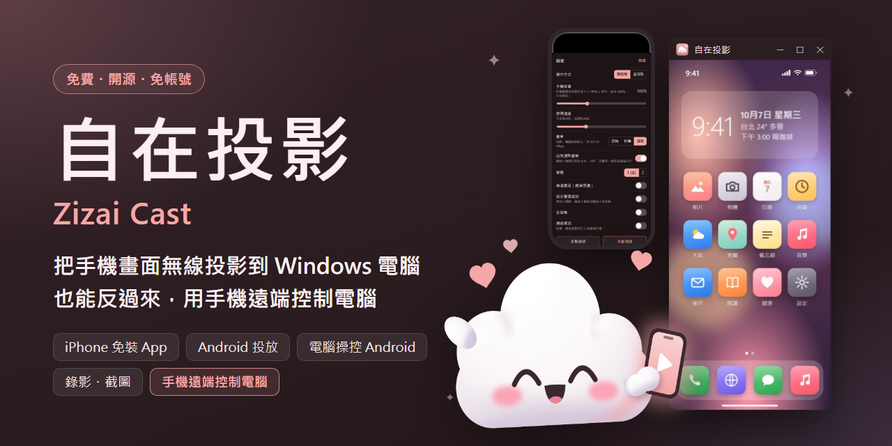

**繁體中文** ・ [English](README.en.md)

# 自在投影 Zizai Cast

**把手機畫面投到 Windows 電腦；也能反過來，用手機遠端控制電腦。** 
iPhone 不用裝 App，Android 還能用滑鼠鍵盤操控；遠端控制只要手機瀏覽器。免費、開源、沒有廣告、不用帳號。

&nbsp;

[介紹頁](https://victor900106.github.io/ZizaiCast/) ・ [所有版本](https://github.com/victor900106/ZizaiCast/releases) ・ [常見問題](#faq) ・ [隱私](#privacy)

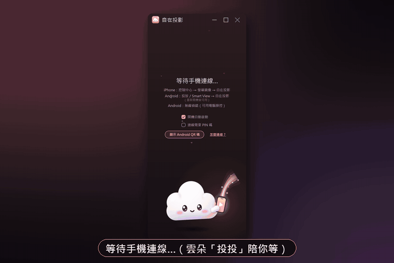

程式實際畫面（離屏錄製，視窗標題列與背景為後製）；手機內容是示範用的合成畫面。

---

## 手機投影：手機畫面到電腦上

手機和電腦連同一個 Wi‑Fi，從手機選「自在投影」，畫面和聲音就出現在電腦上；錄、截、放大、翻譯都在同一個視窗，資料不離開你家的網路。低延遲（電腦端解碼到顯示約 3 ms），最高 4K 60 fps。

**開始前**：[下載並安裝](https://victor900106.github.io/ZizaiCast/download/zizai-setup-latest.exe)（免系統管理員權限），手機和電腦連同一個 Wi‑Fi（不是訪客網路、先關 VPN）。第一次開啟時 Windows 防火牆詢問，請勾「私人網路」。

| | 1 | 2 | 3 |
|---|---|---|---|
| **iPhone / iPad**（AirPlay，免裝 App） | 控制中心 → 「螢幕鏡像」 | 選「自在投影」 | 電腦出現畫面和聲音 |
| **Android：只要看**（Miracast） | 快速設定 →「投放」（Samsung 叫 Smart View） | 選「自在投影」 | 電腦出現畫面（需 Windows「無線顯示器」功能） |
| **Android：用電腦操控**（無線偵錯，Android 11 以上） | 手機「開發人員選項 → 無線偵錯 → 使用 QR 圖碼配對裝置」 | 掃電腦上「連接手機 ▸ 連接 Android（掃 QR）」的 QR 碼 | 滑鼠鍵盤直接操控；之後自動重連 |

忘了怎麼連？程式裡「連接手機 ▸ 怎麼連線？」隨時看得到。iPhone 不能從電腦操控（AirPlay 的限制）。

<table>
<tr>
<td width="33%" valign="top">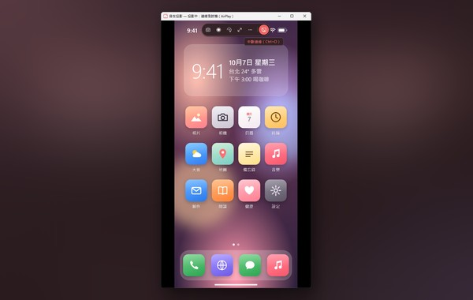 <b>iPhone / iPad 鏡像</b> AirPlay，免裝 App，畫面加聲音。</td>
<td width="33%" valign="top">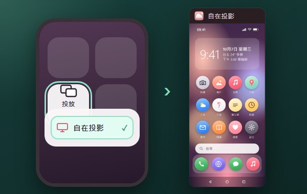 <b>Android 投放</b> 手機內建的「投放／Smart View」直接選自在投影。</td>
<td width="33%" valign="top">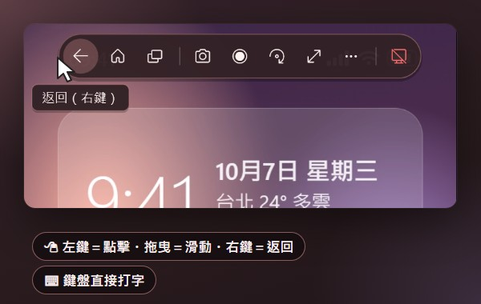 <b>用電腦操控 Android</b> 點擊、滑動、滾輪、打字；掃 QR 碼配對，之後自動重連。</td>
</tr>
<tr>
<td valign="top">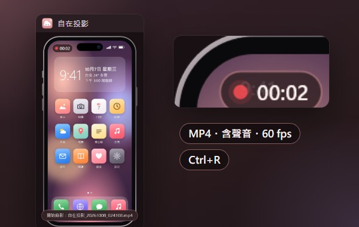 <b>錄影與截圖</b> Ctrl+R 錄 MP4（60 fps、含聲音），Ctrl+S 存 PNG，Ctrl+F 加 iPhone 外框。</td>
<td valign="top">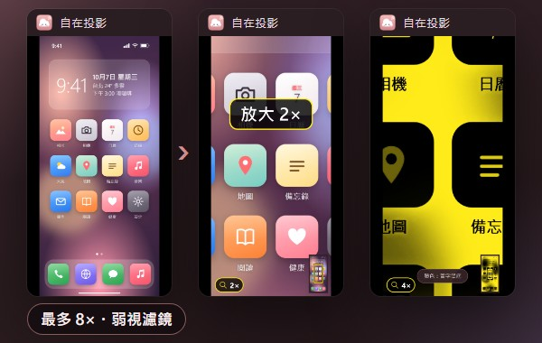 <b>放大鏡與弱視濾鏡</b> 最多 8 倍，加強對比、黑白、反轉、黃字黑底，可凍結畫面。</td>
<td valign="top">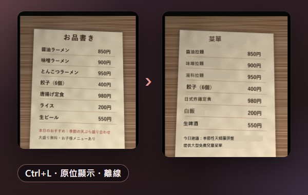 <b>畫面翻譯</b> Ctrl+L：英、日、韓、簡中翻成繁中，離線在電腦上執行。圖中菜單為合成測試圖。</td>
</tr>
</table>

另有簡報畫筆（Ctrl+E）、拖檔到視窗、傳到手機、四種主題、四語介面、一鍵更新（不會自己偷偷更新）。

## 遠端控制：用手機操控電腦

反過來：手機的瀏覽器（iPhone 用 Safari、Android 用 Chrome）就能看到電腦畫面、聽到電腦的聲音，並用手指操控滑鼠和鍵盤，**手機不用裝 App**。預設關閉，在程式主視窗切到「遠端控制」分頁打開。

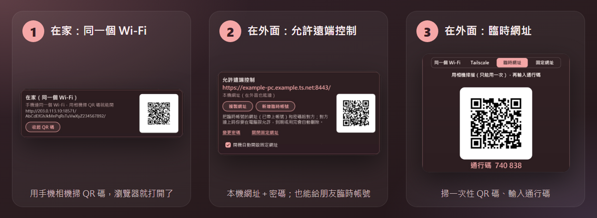

| | 1 | 2 | 3 |
|---|---|---|---|
| **在家**：同一個 Wi‑Fi | 「遠端控制」分頁打開開關，按「顯示 QR 碼」 | 手機相機掃 QR 碼 | 第一次電腦會問「允許」，按下去就開始 |
| **在外面**：固定網址＋密碼（Tailscale Funnel） | 按「設定密碼」（至少 8 個字）、「開啟固定網址」；勾「開機自動開啟固定網址」開機就能連 | 在外面用手機瀏覽器打開固定網址 | 輸入密碼就連上，不用先碰電腦 |
| **臨時網址**（免安裝） | 選「臨時網址」分頁，出現一次性 QR 碼和 6 位數通行碼 | 手機掃 QR 碼，輸入通行碼 | 電腦按「允許」 |

**給朋友用**：你自己只要輸入密碼。要讓別人暫時連進來，在「遠端控制」分頁按「新增臨時帳號」，選有效時間（用一次到 7 天）、可操作或僅觀看、能不能傳檔，再按「複製全部」把網址和密碼傳給對方。網址已經帶上帳號（在 # 後面），朋友打開後也只要輸入密碼；連上時你在電腦按「允許」，到期自動刪除。（需先開固定網址）

<table>
<tr>
<td width="50%" valign="top">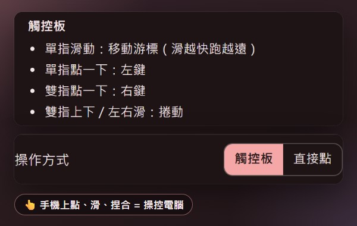 <b>手指操控和觸控板</b> 「直接點」點哪裡按哪裡，或像筆電觸控板；三指點一下叫出鍵盤，有 Ctrl／Alt／Win 組合鍵和雙向剪貼簿。</td>
<td width="50%" valign="top">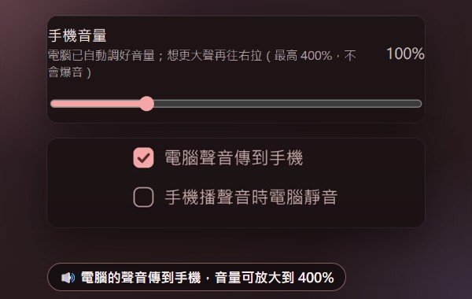 <b>電腦聲音傳到手機</b> 電腦在播什麼，手機就聽到什麼；聲音會自動調到適當大小，手機音量最高 400%。</td>
</tr>
<tr>
<td valign="top">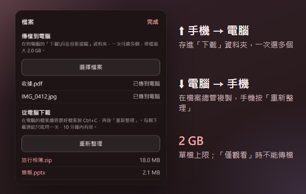 <b>雙向傳檔</b> 手機傳到電腦（存進「下載\自在投影遠端」，單檔最大 2 GB）；電腦在檔案總管複製後，手機按「重新整理」下載。另有多螢幕切換。</td>
<td valign="top">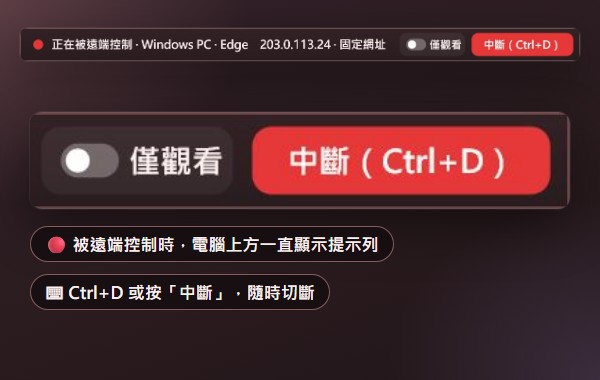 <b>電腦端提示列和 Ctrl+D</b> 連線期間電腦上方一直有提示列，按「中斷」或 Ctrl+D 隨時切斷；也可以開「僅觀看」。</td>
</tr>
</table>

**安全**
- **預設關閉**，要你自己打開；連線時電腦上方有提示列，隨時能中斷。從外面連線的手機斷線後，可以設定自動鎖定電腦。
- **新手機要在電腦上按「允許」**；密碼輸錯會依來源位址限制次數，不會連累別人；電腦只存加密過的雜湊。
- **只用你自己的 Tailscale 帳號**，沒有我們的伺服器；只有選「臨時網址」才經過 Cloudflare。一次只能一支手機，不能操作系統管理員視窗、UAC 和鎖定畫面。

## 新功能

| v0.8.3.5 | |
|---|---|
| **從別台電腦操作** | 在另一台電腦的瀏覽器終於能正常點擊、打字（左右中鍵、滾輪、拖曳、輸入法），滑鼠移到最上方有工具列：全螢幕、切換螢幕、剪貼簿、遊戲模式。 |
| **借給朋友** | 朋友登入後只要按一次「允許」，換畫質、切換螢幕、斷線重連都不會再問；臨時帳號預設可以傳檔。 |
| **固定網址** | 很快地關掉又打開遠端控制，固定網址不會再消失；連點兩下開關只算一次。 |
| **手機頁** | 觸控板模式畫出電腦游標的位置；新增「統計」按鈕；不能傳檔時「檔案」按鈕變灰並說明原因。 |
| **系統管理員視窗** | 點到系統管理員權限的視窗時，手機頁會直接說明為什麼點不到、該怎麼做。 |

完整更新內容見 [Releases](https://github.com/victor900106/ZizaiCast/releases)。

## 需求、下載與其他

<b>系統需求與下載</b>

- **電腦**：Windows 10 / 11，64 位元。手機和電腦在同一個區域網路（建議 5 GHz Wi‑Fi 或電腦接網路線）。
- **iPhone / iPad**：有「螢幕鏡像」即可。**Android 投放**：需 Windows 選用功能「無線顯示器」和支援的 Wi‑Fi 網卡（Pixel 不支援 Miracast，請改用無線偵錯）。**Android 操控**：Android 11 以上、開啟無線偵錯。
- **1440p / 4K**：需要 HEVC 影片延伸模組，沒有時自動用 1080p。
- 下載：[`zizai-setup-<版本>.exe`](https://victor900106.github.io/ZizaiCast/download/zizai-setup-latest.exe)（[Releases 備用](https://github.com/victor900106/ZizaiCast/releases/latest)），免系統管理員權限；Release 頁另有完整原始碼 `source.zip` 和函式庫原始碼 `deps-source.zip`。

<b>實測數據與快捷鍵</b>

開發者在一台電腦上的實測（RTX 3060 Ti，2026 年 10 月），實際會依電腦、Wi‑Fi 和手機而不同：電腦端解碼到顯示約 3 ms；最高 3840×2160、60 fps；連續 61 分鐘無記憶體洩漏。整體延遲還包含手機編碼與 Wi‑Fi。

常用快捷鍵（按 **F1** 看全部）：Ctrl+S 截圖、Ctrl+R 錄影、Ctrl+F 外框、Ctrl+滾輪 放大、Ctrl+L 翻譯、Ctrl+E 畫筆、Ctrl+D 中斷、F11 全螢幕。

## 常見問題

<b>安裝時出現「Windows 已保護您的電腦」？</b>

安裝程式目前沒有數位簽章，SmartScreen 會提醒。按「其他資訊」→「仍要執行」，或從 Release 頁面下載原始碼自己建置。

<b>iPhone 找不到「自在投影」？</b>

手機和電腦要在同一個 Wi‑Fi（不是訪客網路、行動數據；學校、公司、飯店網路可能封鎖）；防火牆要允許「私人網路」；先關 VPN；同一台電腦只能有一個 AirPlay 接收程式。

<b>Netflix、Disney+ 畫面是黑的？</b>

有 DRM 的影片在螢幕鏡像時，手機本身就會把畫面變黑，任何接收程式都無法繞過。YouTube 的「AirPlay 影片」模式也不支援，請用螢幕鏡像。

<b>Android 投放（Miracast）連不上／選單是灰的？</b>

電腦要裝 Windows 選用功能「無線顯示器」（裝完重開機），Wi‑Fi 網卡要支援（`netsh wlan show drivers` 看到 Wireless Display Supported: Yes）；不要同時開行動熱點。不行就改用無線偵錯。

<b>無線偵錯一直斷線？延遲、卡頓或畫面糊？</b>

無線偵錯需要 Android 11 以上；手機重開機後常會自動關閉，再打開即可，仍不行就移除配對、重掃 QR。延遲或畫面糊：改用 5 GHz Wi‑Fi 或讓電腦接網路線，「畫面清晰度」調「標準（順暢）」。

<b>遠端控制要在手機裝 App 嗎？外面怎麼連？</b>

不用，手機瀏覽器就行（也可「加入主畫面」）。最推薦「固定網址＋密碼」：電腦裝好 Tailscale 並開啟 Funnel，在「遠端控制」分頁設定密碼、開啟固定網址，到外面打開網址輸入密碼；不想裝就用「臨時網址」（免安裝，要在電腦旁產生 QR 碼）。都不用在路由器開連接埠。

<b>遠端控制安全嗎？沒有聲音怎麼辦？</b>

預設關閉；新手機要在電腦按「允許」；密碼連續輸錯會被暫時擋掉；連線時電腦有提示列，Ctrl+D 隨時中斷，也能開「僅觀看」。仍請設夠長的密碼，不要把網址和密碼一起貼給別人。沒有聲音：按手機畫面下方「開啟聲音」；電腦要真的在播放聲音，且「遠端控制」分頁勾了「電腦聲音傳到手機」；也可在手機頁設定調高「手機音量」。

<b>關掉視窗後程式跑去哪了？有 Mac / Linux 版嗎？真的免費嗎？</b>

選了「背景待命」時，程式在背景繼續接收，按工作列右邊的圖示打開（沒看到先按「^」），要結束請在圖示上按右鍵 →「結束」。目前只有 Windows 10 / 11（64 位元）。是的，免費：GPL-3.0 開源，沒有付費版、廣告和資料收集。

<b>目前的限制</b>

iPhone 不能從電腦操控；有 DRM 的影片是黑畫面；Miracast 需要「無線顯示器」功能且聲音不會錄進錄影檔；Android 無線偵錯需要 Android 11 以上；遠端控制不能操作系統管理員視窗、UAC 和鎖定畫面，一次只能一支手機；安裝程式沒有數位簽章；只支援 Windows 10 / 11 64 位元。

## 隱私

- **畫面、聲音、錄影、截圖都只在你的區域網路與電腦裡**，不經過任何伺服器；沒有遙測、分析、廣告，不用帳號。
- 程式平常唯一的對外連線是**檢查更新**（向 `github.com/victor900106/ZizaiCast/releases/latest/download/update.json` 發一個 HTTPS GET，不帶裝置資訊；只有按「更新到 vX.Y.Z」才下載安裝程式並以 SHA-256 驗證）。在 `%LOCALAPPDATA%\PhoneMirror\settings.ini` 加一行 `update_url=` 即可關閉。
- **畫面翻譯完全在電腦上離線執行**；模型下載前會先詢問、以 SHA-256 驗證；本機 AI 翻譯和線上翻譯（預設關閉，需自己的 DeepL／Azure／Google 金鑰，只送辨識出的文字）都只在你選用時才連線。
- **傳到手機只在區域網路**；**遠端控制預設關閉**，外部服務（你自己的 Tailscale、固定網址、Cloudflare 臨時網址）只在你選用時才經過。
- 設定與記錄檔存在 `%LOCALAPPDATA%\PhoneMirror`，只在你的電腦上。各連線的程式碼位置見[教學與原始碼](https://github.com/victor900106/ZizaiCast/tree/main/docs)。

## 建置、授權與致謝

從原始碼建置需要 Visual Studio 2026 Build Tools、CMake 3.25+、vcpkg；步驟見每個 Release 附的 `source.zip` 裡的 `BUILD.md`。想幫忙請看 [CONTRIBUTING.md](CONTRIBUTING.md)，回報問題請用 [Issues](https://github.com/victor900106/ZizaiCast/issues/new/choose)。

自在投影以 GPL-3.0 散布（[LICENSE](LICENSE)），每個版本的完整對應原始碼都附在同一個 GitHub Release 頁面；第三方元件的版本、授權與原始碼提供方式見 [`docs/licenses/`](docs/licenses/)。站在 [UxPlay](https://github.com/FDH2/UxPlay)、[scrcpy](https://github.com/Genymobile/scrcpy)、FFmpeg、OpenSSL、libplist、Bergamot／Firefox Translations、ONNX Runtime、PaddleOCR、llama.cpp、Qwen 等開源專案的肩膀上。吉祥物雲朵精靈「投投」是本專案的原創角色。

---

[下載最新版](https://victor900106.github.io/ZizaiCast/download/zizai-setup-latest.exe) ・ [介紹頁](https://victor900106.github.io/ZizaiCast/) ・ [回報問題](https://github.com/victor900106/ZizaiCast/issues/new/choose)

覺得好用的話，在 GitHub 按個 Star，讓更多人找到自在投影。

